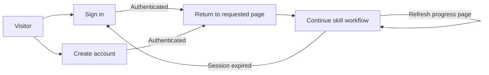

# FE-02 — User flows and API touchpoints

**Status:** Draft for Backend and AI review  
**Scope:** SkillForge V1 user journeys, with V2/V3 destinations shown where the frontend task plan requires them.  
**Language and direction:** Arabic-first, right-to-left UI, following the current interface. Route and API names remain platform-neutral/English.

## Product flow

```mermaid
flowchart TD
    H[Home] --> N[Describe skill and choose platforms]
    N -->|POST /skills/requests| A[Request analysis]
    A -->|Questions returned| Q[Answer 3–5 clarifying questions]
    Q -->|POST /skills/requests/{id}/answers| G[Gap check]
    A -->|No questions / continue| G
    G -->|Good match| E[Existing skill options]
    E -->|Use| D[Skill detail]
    E -->|Customize| N
    E -->|Generate new| P[Generation progress]
    G -->|No good match / generate new| P
    P -->|Draft SkillSpec ready| R[Review and edit]
    R -->|Compile for Claude Code or Codex| V[Package preview]
    V --> I[Install help]
    I --> Z[Result and download]
    Z --> M[My skills]
    L[Skill library] --> D
    D --> Z
    M --> F[Rate and send feedback]
    M -. V2 .-> ER[Evaluation report]
    ER -. V3 .-> OH[Optimizer history]
```

The gap-check position relative to the clarifying-questions request and whether “customize” reuses a request or starts a new one must be confirmed with Backend and AI. The diagram shows the intended user choices; it does not claim these transitions already exist in the API.

## Account and interruption flows



- Authentication provider behavior and callback paths depend on BE-04.
- The frontend should preserve a safe return path after sign-in. Whether an in-progress request can be resumed after sign-in must be confirmed with Backend.
- FE-10 requires job progress to survive a page refresh. The job ID and progress source must therefore be reloadable from the agreed job API/SSE contract.
- Sign-out returns to Home and clears protected user data from the visible session.

## Route map proposal

These are frontend route suggestions to make the wireframes concrete; they are not API paths and remain open to Backend review.

| Screen                   | Proposed route                                    | Task  |
| ------------------------ | ------------------------------------------------- | ----- |
| Home                     | `/`                                               | FE-02 |
| Sign in / create account | `/auth/sign-in`, `/auth/sign-up`                  | FE-07 |
| Create a skill           | `/skills/new`                                     | FE-05 |
| Clarifying questions     | `/skills/requests/[requestId]/questions`          | FE-08 |
| Gap-check result         | `/skills/requests/[requestId]/match`              | FE-09 |
| Live progress            | `/skills/jobs/[jobId]`                            | FE-10 |
| Result and download      | `/skills/jobs/[jobId]/result`                     | FE-06 |
| SkillSpec review         | `/skills/[skillId]/review`                        | FE-11 |
| Package preview          | `/skills/[skillId]/preview`                       | FE-12 |
| Install help             | `/skills/[skillId]/install`                       | FE-13 |
| Skill library            | `/library`                                        | FE-14 |
| Skill detail             | `/library/[skillId]`                              | FE-15 |
| My skills                | `/my/skills`                                      | FE-16 |
| Evaluation report (V2)   | `/my/skills/[skillId]/evaluations/[evaluationId]` | FE-25 |
| Optimizer history (V3)   | `/my/skills/[skillId]/history`                    | FE-26 |

## API touchpoint inventory

“Specified” means the path appears in the supplied Project Specification v2.0. Where the Frontend Task Plan names a dependency but the API document omits a path or payload, the contract stays open; the frontend must not invent one.

| Journey step                  | Contract currently documented                                                             | Contract still needed                                                                      |
| ----------------------------- | ----------------------------------------------------------------------------------------- | ------------------------------------------------------------------------------------------ |
| Submit a skill request        | `POST /skills/requests` returns clarifying questions.                                     | Request/response schema, auth requirement, and how a no-question request proceeds.         |
| Save answers and start work   | `POST /skills/requests/{id}/answers`; BE-05 owns create/answer/read request endpoints.    | Answer schema, skip behavior, returned job/request IDs, validation errors.                 |
| Gap check                     | AI-08 and BE-11 supply matching against the registry.                                     | Frontend endpoint, match result shape/threshold, and use/customize/generate actions.       |
| Read progress and sources     | `GET /skills/jobs/{id}`; BE-08 supplies browser progress events via SSE.                  | SSE URL, event names/payloads, reconnect/resume behavior, and error representation.        |
| Read or edit SkillSpec        | AI-01 supplies `schema.json`; BE-09 supplies compiler/validator.                          | Read/update endpoint, save semantics, validation response schema, and schema version.      |
| Compile and preview           | `POST /skills/{id}/compile?platform=claude` is listed; BE-09 owns Claude/Codex compilers. | Codex query value, compile response, file-preview retrieval, raw/rendered source contract. |
| Download package              | `GET /skills/{id}/download?platform=codex`; BE-10 builds ZIPs and expiring links.         | Response form (stream or redirect), expiry/error shape, checksum field.                    |
| Search library                | `GET /skills?query=…`; BE-11 owns registry search and versions.                           | Pagination, filters/categories, sort order, and response fields.                           |
| Read skill detail and sources | BE-11 owns registry publish/version/search.                                               | Detail/version/source/file endpoint and source-citation schema.                            |
| My skills and rating          | BE-12 owns ratings and feedback endpoints.                                                | User-skill list endpoint, rating scale, feedback schema, and permissions.                  |
| Sign up/in/out                | BE-04 owns email and GitHub/Google authentication.                                        | OpenAPI paths, session model, callback/error responses.                                    |
| Evaluation report (V2)        | `POST /skills/{id}/evaluate`; AI-16 runs the benchmark.                                   | Evaluation job/result read endpoints, metric schema, and pending/failed states.            |
| Optimizer history (V3)        | AI-23 owns optimization.                                                                  | Version/history endpoint and fields used to compare variants.                              |

## Review needed before FE-02 approval

### Backend review

1. Confirm request → questions → gap-check ordering and the IDs returned at each step.
2. Publish the OpenAPI paths and schemas for gap check, progress/SSE, SkillSpec editing, preview files, detail/version/source data, user skills, ratings, and evaluations.
3. Confirm auth requirements, persistence after refresh, pagination, expiry, and error/retry behavior.
4. Confirm whether the proposed frontend routes fit the API resource boundaries.

### AI review

1. Confirm the SkillSpec sections and which fields are user-editable in FE-11.
2. Confirm the 3–5 clarifying-question behavior and gap-check result states/actions.
3. Name the progress phases and source/citation fields the UI can display.
4. Confirm evaluation metrics for V2 and the version/change data exposed for V3.

## Scope notes

- Claude Code and Codex are the V1 platform choices. ChatGPT and generic Markdown are V2; other agents are later.
- Billing and a paid marketplace are out of scope for V1. The current mock’s upgrade prompt should not become a required V1 flow.
- The current chat-like screen is a starting shell. The product’s primary V1 journey is a skill request and package workflow, not an open-ended chat product.
- Source docs are versioned differently: the attached task plan is v2.1 and refers to Project Specification v2.1, while the attached project specification is v2.0. This draft follows the task IDs from the task plan and uses v2.0 for documented API paths; resolve version differences during review.

## Acceptance status

The flows and API questions are prepared for review. FE-02 is not fully accepted until Backend and AI review the flows and wireframes, as required by the task plan.
